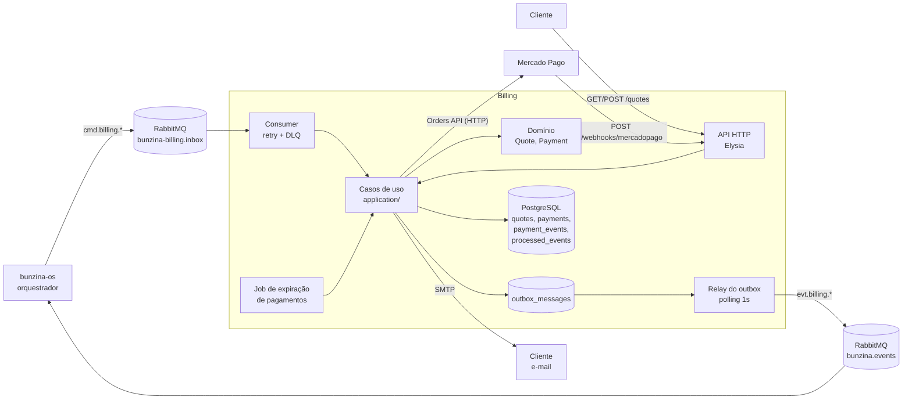

# bunzina-billing

Microsserviço de **Orçamento e Pagamento** do Bunzina (Fase 4 do Tech Challenge). É dono do
**Orçamento** e do **Pagamento**: emite o orçamento pós-diagnóstico, registra a aprovação do
cliente, cobra pelo Mercado Pago (Checkout Pro, sandbox) e estorna quando a oficina falha
depois do pagamento. Vocabulário em [GLOSSARY.md](GLOSSARY.md).

O serviço participa da saga orquestrada pelo [`bunzina-os`](https://github.com/Bunzina/bunzina-os):
obedece a quatro comandos e publica sete eventos, todos do
[contrato congelado](https://github.com/Bunzina/bunzina/blob/main/docs/contracts/events-saga-contracts.md).

## Arquitetura



Clean Architecture em `src/`:

| Pasta | Conteúdo |
| --- | --- |
| `domain/` | `Quote` e `Payment` com as regras (total, validade, transições), e as portas: repositórios, `PaymentGateway`, mailers e o registro de eventos. Sem I/O |
| `application/` | Um caso de uso por comando ou rota: emitir, aprovar/recusar, cancelar, cobrar, tratar notificação, expirar pagamentos e estornar |
| `api/` | Rotas Elysia (`/quotes`, `/webhooks/mercadopago`), a documentação OpenAPI e o `server.ts`, que monta tudo |
| `infrastructure/` | Postgres (`persistence/`, `message-store.ts`), RabbitMQ (`messaging/`), Mercado Pago por HTTP direto (`mercadopago/`), SMTP, jobs periódicos e observabilidade |
| `test/` | Repositórios em memória, gateway e mailers falsos: as regras rodam sem rede nem banco |

Decisões que moldam o serviço:

- **Banco próprio** (PostgreSQL, schema `bunzina`): `quotes`, `payments`, `payment_events`,
  `processed_events` e `outbox_messages`. Diagrama ER no repositório `bunzina`:
  [er-billing.md](https://github.com/Bunzina/bunzina/blob/main/docs/arch/diagrams/er-billing.md).
- **Outbox transacional.** Todo evento de saída é gravado na mesma transação da escrita de
  negócio e publicado por um relay com `FOR UPDATE SKIP LOCKED`, seguro com 2+ réplicas.
- **Idempotência.** O consumer grava `processed_events` na transação do handler; o webhook,
  que não tem `eventId`, usa atualização condicional (`status = 'PENDING'`).
- **Pagamento por Orders API do Mercado Pago**, sem SDK:
  [ADR 0002](docs/adr/0002-checkout-pro-via-orders-api.md). Falha de pagamento e pagamento
  tardio: [ADR 0001](docs/adr/0001-payment-failure-and-late-payment.md).
- **Webhook público pelo ALB** do cluster (Ingress `alb`, `internet-facing`). O endereço é a
  configuração `PUBLIC_BASE_URL`, então trocar por um túnel não muda código.

### Mensagens

| Comando consumido | Eventos publicados |
| --- | --- |
| `cmd.billing.issue-quote` | `evt.billing.quote-issued` |
| `cmd.billing.cancel-quote` | `evt.billing.quote-canceled` |
| `cmd.billing.charge` | `evt.billing.payment-failed` (erro do provedor) |
| `cmd.billing.refund` | `evt.billing.payment-refunded` |
| rota `POST /quotes/:id/approval` | `evt.billing.quote-approved`, `evt.billing.quote-rejected` |
| webhook e job de expiração | `evt.billing.payment-confirmed`, `evt.billing.payment-failed` (expiração) |

## API HTTP e Swagger

| Rota | Uso |
| --- | --- |
| `GET /quotes/:id` | Consulta o orçamento; documento do cliente no header `X-Customer-Document` |
| `POST /quotes/:id/approval` | Aprova ou recusa; corpo `{ "document", "decision": "APPROVED" \| "REJECTED" }` |
| `POST /webhooks/mercadopago` | Notificação do Mercado Pago, protegida pela assinatura `x-signature` |
| `GET /health`, `/ready`, `/metrics` | Probes e métricas Prometheus |

O **Swagger** fica em `/swagger` (o `/` redireciona para ele) e o JSON OpenAPI em
`/swagger/json`:

- local: <http://localhost:3000/swagger>
- cluster: `http://<host do ALB>/swagger`; o host sai de `kubectl get ingress -n bunzina`.

A **collection do Bruno** está em [`bruno/`](bruno/): abra a pasta no Bruno, escolha o
ambiente `Local` e preencha `quoteId` (vem do `evt.billing.quote-issued`) e, para o webhook,
`merchantOrderId` e o segredo `webhookSecret` (o mesmo `MP_WEBHOOK_SECRET`; o script do
request assina a notificação). Tem as três rotas de negócio.

## Como executar

Requisitos: [Bun](https://bun.sh) e Docker.

```bash
bun install
docker compose up -d db rabbitmq            # Postgres (5432) e RabbitMQ (5672, painel em 15672)
docker compose run --rm app bun run migration   # aplica as migrations pendentes
docker compose up                           # a API em http://localhost:3000, com hot reload
```

Sem `MP_ACCESS_TOKEN` e `MP_WEBHOOK_SECRET` (o `docker compose` os lê do ambiente ou do
`.env`) a API sobe, mas o webhook não é servido e `cmd.billing.charge` e
`cmd.billing.refund` vão para a DLQ. Variáveis na seção [Configuração](#configuração).

```bash
bun test                    # unitários, em memória
bun run test:ci             # o mesmo com o gate de cobertura que o CI executa
bun run test:integration    # sobe um Postgres descartável (db-test, 5433) e roda a suíte contra ele
bun run lint && bun run fmt:check
```

## Testes e cobertura

O serviço tem dois níveis de teste, ambos pelas portas de entrada (HTTP e mensageria), nunca
por detalhe interno:

- **Unitários** com repositórios em memória e fakes de gateway, e-mail e relógio. É o que o
  gate de cobertura mede.
- **Integração** contra Postgres real (transação com `processed_events`, outbox e relay com
  duas instâncias, índices únicos). Rodam no job `test/integration` do CI, fora do gate; o
  `lcov` deles segue para o SonarCloud junto com o dos unitários.

**Evidência de cobertura** (`bun run test:ci`, 240 testes passando):

| Dimensão | Resultado | Mínimo exigido |
| --- | --- | --- |
| Linhas | 99,37% | 80% |
| Funções | 99,26% | 80% |

O `bunfig.ci.toml` fixa `coverageThreshold` de 80% em linhas, funções, statements e
branches, e o Bun reprova o job se algum limite não for atingido. O relatório de texto do Bun
só imprime linhas e funções. O `message-store.ts` e os repositórios `postgres-*.ts`, que são só SQL,
ficam fora do gate unitário (o Bun mede o limite por arquivo) e são medidos pela integração.
O CI publica o `coverage/lcov.info` no SonarCloud (`Bunzina_bunzina-billing`), e o
quality gate é um check obrigatório do PR.

## Mensageria (`src/infrastructure/messaging`)

A parte que precisa ser **idêntica** nos quatro serviços, e que a
[ADR 0016](https://github.com/Bunzina/bunzina/blob/main/docs/arch/adrs/0016-code-reuse-between-services.md) marca para virar
pacote npm. Enquanto o pacote não existe, ela vive aqui.

| Arquivo | Responsabilidade |
| --- | --- |
| `envelope.ts` | Schema Zod do envelope e enum de `reason`. Critério de aceite nº 1 do contrato |
| `connection.ts` | Canal único por processo, topologia (exchange topic, fila, DLX, DLQ) e prefetch |
| `publisher.ts` | Publica com o `eventType` como routing key e injeta o `traceparent` nos headers AMQP |
| `consumer.ts` | Extrai o `traceparent`, roda o handler numa transação junto com a guarda de idempotência, repete falhas transitórias (3 tentativas, backoff exponencial) e faz ack/nack |
| `message-store.ts` | Porta `MessageStore` e a implementação Postgres: transação, `processed_events` e outbox |
| `outbox-relay.ts` | Publica o outbox por polling de 1s em lotes com `FOR UPDATE SKIP LOCKED`, esperando o confirm do broker |

O contrato completo está em
[docs/contracts/events-saga-contracts.md](https://github.com/Bunzina/bunzina/blob/main/docs/contracts/events-saga-contracts.md).

### Como o handler de uma mensagem funciona

O handler de cada mensagem recebe `{ envelope, tx, emit }`. A guarda de idempotência
grava em `processed_events` **na mesma transação** da escrita de negócio, e o `emit`
grava o evento de saída no outbox nessa mesma transação, com o `serviceOrderId` como
`correlationId` e o `eventId` da mensagem de origem como `causationId`. Um redelivery
do RabbitMQ é confirmado sem efeito, então não cobra o cliente duas vezes.

Um handler que considera a mensagem inválida lança `InvalidMessageError`: ela vai
direto para a DLQ, sem retry. Qualquer outro erro é repetido até 3 vezes.

Testes: os unitários usam o `MessageStore` em memória (`src/test`). Os de integração
(`bun run test:integration`, que sobe um Postgres descartável local, o `db-test` na
porta 5433, e nunca roda contra outro banco) provam o
que mock não prova: a transação, o outbox e o `SKIP LOCKED` com duas instâncias. Eles
rodam no job `test/integration` do CI, fora do gate de 80%. O `lcov` deles segue para o
SonarCloud junto com o dos unitários. O `message-store.ts`, que é só SQL, fica fora do
gate unitário (o Bun mede o limite de 80% por arquivo) e é medido apenas pela
integração.

`processed_events` tem chave primária composta `(event_id, consumer)`.

## Comportamento por fluxo

### Emissão do orçamento

O orquestrador manda `cmd.billing.issue-quote` com os itens diagnosticados. O Billing
calcula o total (serviços + peças, `quantidade × preço unitário`, em centavos), fixa os
itens e a validade, grava o **Orçamento**, publica `evt.billing.quote-issued` pelo outbox
e envia o orçamento ao cliente por e-mail.

- **Um orçamento ativo por OS.** Emitido ou aprovado conta como ativo. Um comando novo
  para uma OS que já tem orçamento ativo não cria outro: reemite `quote-issued` do
  existente. Depois de uma recusa a OS pode receber um novo. O índice único parcial
  `uq_quotes_active_per_order` garante isso também com duas réplicas concorrentes.
- **Payload inválido** (sem itens, total zero, campo faltando ou moeda que não seja um código de 3 letras maiúsculas)
  vai direto para a DLQ, sem retry.
- **E-mail depois do commit.** O envio roda só quando a transação confirmou e nunca para
  uma mensagem repetida. Falha de SMTP gera log e `billing_email_failures_total`, e não
  impede a emissão. Para isso o handler recebe `afterCommit(work)` além de `tx` e `emit`.
- **Consulta**: `GET /quotes/:id` com o documento no header `X-Customer-Document`
  devolve itens, totais e situação. Documento divergente, ausente ou id inválido
  respondem 404. Um orçamento emitido e vencido aparece como `EXPIRED`.

### Cobrança (`cmd.billing.charge`)

Depois da aprovação o orquestrador manda `cmd.billing.charge` com o `quoteId` e o total. O
Billing cria o **Pagamento** e a order de Checkout Pro no Mercado Pago
([ADR 0002](docs/adr/0002-checkout-pro-via-orders-api.md)), grava o link, e envia o link ao
cliente por e-mail. O link também sai em `GET /quotes/:id` (`checkoutUrl`, só enquanto o
pagamento está pendente). A confirmação chega pelo webhook, abaixo.

- **Só orçamento aprovado e total igual.** Orçamento desconhecido, de outra OS, que não
  está aprovado, ou com total ou moeda diferentes do comando, vai direto para a DLQ.
- **Um pagamento por orçamento.** O índice único `uq_payments_quote_id` garante isso. Outra
  cobrança para o mesmo orçamento não chama o provedor nem envia outro e-mail.
- **Erro do provedor.** Erro transitório (rede, 429, 5xx) é repetido até 3 vezes dentro do
  handler, com backoff. Esgotadas as tentativas, ou diante de um erro que não adianta repetir
  (outro 4xx), o pagamento fica `FAILED` com `PROVIDER_ERROR` e sai `evt.billing.payment-failed`.
  Esse pagamento não é cobrado de novo: reenviar o comando só reemite o evento. O
  `providerStatus` do evento é `http_<código>` ou `unreachable`, e fica em `failure_detail`.
- **Mercado Pago por HTTP direto**, sem SDK (`src/infrastructure/mercadopago`). Os centavos viram
  o decimal do provedor (`"210.05"`) só ali. A order sai com `expiration_time` em ISO 8601 e
  `not_allowed_types: ["ticket"]` (boleto fora), e o id do Pagamento como `external_reference`
  e `X-Idempotency-Key`. Só `BRL` é aceita.
- **E-mail depois do commit**, como no orçamento: falha vira log e
  `billing_email_failures_total{template="payment-link"}`, e não desfaz a cobrança.

### Webhook (`POST /webhooks/mercadopago`)

O Mercado Pago notifica o webhook configurado no painel da aplicação
([ADR 0002](docs/adr/0002-checkout-pro-via-orders-api.md)). O corpo nunca decide nada.

- **Assinatura.** Sem `x-signature` válido (HMAC-SHA256 do manifest `id;request-id;ts` com
  `MP_WEBHOOK_SECRET`) a resposta é `401`. Isso inclui o formato antigo (`?topic=&id=`), que não
  traz `data.id`. Sem `MP_WEBHOOK_SECRET` ou `MP_ACCESS_TOKEN` a rota nem é servida.
- **Estado vem da API.** O Billing consulta a `merchant_order` (traz o `external_reference`, o id
  do Pagamento), acha o Pagamento e consulta a order pelo `provider_payment_id`.
- **Tudo fica em `payment_events`.** Cada notificação grava `webhook-received` ou
  `webhook-rejected` antes de qualquer consulta (o corpo gravado é cortado em 8 KiB). O desfecho vira outra linha com o
  `payment_id`: `payment-confirmed`, `payment-approval-ignored` (o pagamento já não estava
  pendente), `payment-declined` ou `webhook-unmatched`.
- **Confirma uma vez.** `UPDATE ... WHERE status = 'PENDING'` e o `payment-confirmed` entram na
  mesma transação. Duplicata, notificação fora de ordem ou duas réplicas ao mesmo tempo: só quem
  muda a linha publica. `payment-confirmed` leva o id do provedor (a order), o método
  (`pix`, `credit_card`...) e `paidAt`, que é a última atualização da order.
- **Cartão recusado** só entra no registro: não publica `payment-failed` e não altera o Pagamento
  ([ADR 0001](docs/adr/0001-payment-failure-and-late-payment.md)).
- **Provedor fora do ar**, ou `merchant_order` ainda não consultável (`404`), responde `502`, para o Mercado Pago entregar de novo. Notificação sem
  Pagamento correspondente responde `200` (não adianta repetir).
- **Pagamento tardio.** Aprovação que chega com o Pagamento já `FAILED` (cancelamento, timeout
  ou expiração) é estornada na hora, com o id do Pagamento como chave de idempotência. O
  Pagamento continua `FAILED`, ganha `provider_refund_id` e `refunded_at`, e o estorno entra em
  `payment_events` como `late-payment-refunded`. Não publica evento de saga
  ([ADR 0001](docs/adr/0001-payment-failure-and-late-payment.md)). Se o provedor falhar, responde
  `502` e o Mercado Pago entrega de novo; uma notificação repetida depois do estorno só é
  registrada (`payment-approval-ignored`).

Métricas: `billing_payments_total{status}`, `billing_late_payments_refunded_total` e
`billing_mercadopago_request_duration_seconds{operation,result}` (`operation` é `create_order`,
`get_merchant_order`, `get_order`, `cancel_order` ou `refund_order`; `result` é `success` ou
`error`).

### Estorno (`cmd.billing.refund`)

O orquestrador manda estornar um Pagamento `CONFIRMED` (`serviceOrderId`, `paymentId`,
`amountCents`, `currency`, `reason`). O Billing estorna o valor integral em
`POST /v1/orders/{id}/refund`, com o id do Pagamento como `X-Idempotency-Key`, marca o
Pagamento como `REFUNDED` com `provider_refund_id` e `refunded_at`, registra
`payment-refunded` em `payment_events` e publica `evt.billing.payment-refunded` com
`providerRefundId`.

- **Repetido:** num Pagamento já `REFUNDED` não chama o provedor e reemite
  `payment-refunded` com o estorno original.
- **Não confirmado:** Pagamento `PENDING` ou `FAILED`, valor ou moeda diferentes do Pagamento,
  OS que não confere ou Pagamento inexistente vão para a DLQ, e o alerta da DLQ dispara.
- **Provedor fora do ar:** o consumidor repete com espera e, esgotadas as tentativas, a mensagem
  vai para a DLQ com o Pagamento ainda `CONFIRMED`. A chave de idempotência torna a repetição
  segura. Se a order já estiver estornada sob outra chave (`409 order_already_refunded`), o
  adaptador lê o estorno existente na order.

Métrica: `billing_refunds_total` (estornos mandados pela saga; os tardios têm a sua própria).

## Configuração

| Variável | Padrão | Uso |
| --- | --- | --- |
| `QUOTE_VALIDITY_HOURS` | `72` | Validade do orçamento; vazio ou inválido volta para 72 |
| `EMAIL_SMTP_HOST` / `_PORT` / `_USER` / `_PASSWORD` | — | Servidor SMTP |
| `EMAIL` | `bunzina@local.com` | Remetente |
| `PAYMENT_LINK_VALIDITY_MINUTES` | `30` | Validade do link de pagamento, em minutos inteiros; vazio ou inválido volta para 30 |
| `MP_ACCESS_TOKEN` | — | Token do Mercado Pago (secret). Sem ele o `cmd.billing.charge` e o `cmd.billing.refund` não são consumidos e vão para a DLQ, e o webhook não é servido |
| `MP_WEBHOOK_SECRET` | — | Segredo de assinatura do webhook do Mercado Pago (secret) |
| `PUBLIC_BASE_URL` | — | Endereço público do ALB, base das URLs que o Mercado Pago chama |

No cluster o host, a porta e o remetente vêm do `values.yaml` (mailcatcher do release
`bunzina-observability`, sem autenticação). Para um SMTP real, cadastre os secrets
opcionais `EMAIL_SMTP_USER` e `EMAIL_SMTP_PASSWORD`: o deploy só os injeta quando
`EMAIL_SMTP_USER` existe.

`MP_ACCESS_TOKEN` e `MP_WEBHOOK_SECRET` são secrets do repositório e `PUBLIC_BASE_URL` é uma
variável (`vars`), porque o endereço do ALB só existe depois do primeiro deploy. O
deploy só injeta cada um quando está preenchido.

O SMTP usa TLS implícito só na porta 465; nas demais, STARTTLS quando o servidor oferece.

## Métricas e alerta

Orçamentos: `billing_quotes_total{status}`. Pagamentos, estornos e latência do Mercado Pago estão nas seções de cada fluxo.

Alerta: o chart publica `templates/grafana-alerts.yaml`, um ConfigMap com o label
`grafana_alert: "1"` que dispara quando alguma mensagem vai para a DLQ
(`bunzina_billing_messages_consumed_total{result=~"invalid|failure|unhandled"}`). Ele só
chega ao Grafana se o release `bunzina-observability` tiver `grafana.sidecar.alerts.enabled`.
